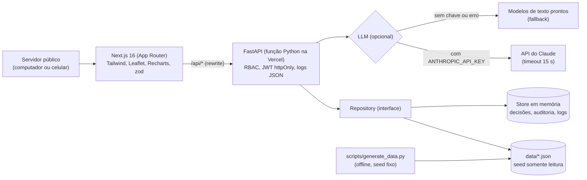

# Prevora

**Prevora** é uma plataforma web de **gestão preventiva** para a Prefeitura de Londrina (PR), com dois módulos sobre a mesma base de dados: **Resíduos** (descarte irregular e entulho) e **Alagamentos**. MVP de hackathon — **todos os dados são simulados**.

> Estado atual: **Fase 7 — release da demo** (todas as fases concluídas). Documentação interativa da API em `/api/docs`. Roteiro de apresentação em [`docs/DEMO.md`](docs/DEMO.md).
>
> **Nome do produto:** antes "Londrina Limpa", agora **Prevora**. A URL de produção, o projeto da Vercel (`londrina-limpa`) e o repositório mantêm o nome antigo por motivos técnicos.

**No ar:** <https://londrina-limpa.vercel.app> · [saúde da API](https://londrina-limpa.vercel.app/api/health) · [documentação da API](https://londrina-limpa.vercel.app/api/docs)

## Stack

- **Frontend:** Next.js 16 (App Router) + TypeScript + Tailwind CSS 4, mapa com Leaflet/react-leaflet (tiles do OpenStreetMap) e validação de formulários com zod.
- **Backend:** Python + FastAPI, um único app, publicado como função serverless Python na Vercel (`api/index.py`).
- **Dados:** arquivos JSON em `data/` (somente leitura na Vercel).

## Telas do frontend (Fase 4)

| Rota | Tela | Perfis |
| --- | --- | --- |
| `/login` | Login (e-mail e senha, validação com zod) | público |
| `/` | Painel de gestão: KPIs, criticidade, áreas mais críticas, alertas urgentes | todos |
| `/mapa` | Mapa e alertas: camadas, filtros, horizonte (agora, +24 h, +72 h, +3 meses), visão em lista | todos |
| `/alertas` | Lista de alertas com filtro por gravidade e tipo | todos |
| `/pontos/[id]` | Resumo de um ponto de descarte | todos |
| `/saude` | Saúde do sistema (versão, dados carregados) | só Administrador |
| `/previsoes` | KPIs de impacto, gráficos por ano e próximos 3 meses (sem ação × com plano), calendário sazonal, resumo de IA | todos |
| `/pontos`, `/pontos/[id]` | Lista de reincidentes com filtros/ordenação; detalhe com previsão, linha do tempo, decisões | todos (decisão: admin, gestor, técnico) |
| `/conscientizacao` | Cartaz A4 (imprimir/PDF), post, porta a porta e plano de 30 dias; seletor de público e tom | admin, gestor |

- **Sessão:** o cookie `ll_session` (JWT, httpOnly) é criado pela API. O `proxy.ts` faz só uma checagem otimista (sem cookie → `/login`); a validação real é da API (401 → volta ao login com aviso de sessão expirada).
- **Acessibilidade:** categorias por forma + rótulo (círculo = alagamento, quadrado = entulho, losango = reincidente), criticidade por cor + texto + símbolo, tema claro/escuro, modo Acessibilidade (Okabe-Ito, para daltonismo), foco visível, alvos de 44 px, link "Ir para o conteúdo" e visão em lista como alternativa ao mapa.
- **Resiliência:** cliente de API com timeout e nova tentativa, skeletons, faixa offline com últimos dados em cache, aviso de falha dos tiles com visão em lista, Error Boundary e envio de erros para `POST /api/logs/client`.

## Problema → solução

**Problema.** A cidade *responde* ao lixo e ao alagamento depois que acontecem: o descarte irregular volta ao mesmo ponto, o Lago Igapó transborda quando lixo e chuva forte se somam, e os dados da CMTU, da CTD (Londrina ON) e da Defesa Civil não conversam.

**Solução.** A Prevora junta histórico, chuva e reincidência numa só base e entrega ao servidor **o que fazer primeiro, antes**: onde o lixo volta e quando, quais áreas têm risco de alagamento em 24 h, 72 h e 3 meses, quais pontos exigem ação além da limpeza, e quanto o plano economiza. Ela **só analisa**: não abre chamados e não coleta dados de cidadãos. Os números vêm de modelos estatísticos; a IA só escreve textos (sempre com revisão humana e com fallback de modelos prontos).

## Arquitetura



As previsões pesadas são **pré-calculadas** pelo script e gravadas em JSON; a função serverless só lê e serve (importação + seed em cerca de 0,9 s no cold start; respostas grandes saem com gzip).

## Testes e qualidade (Fase 7)

| Camada | Ferramenta | Comando | Escopo |
| --- | --- | --- | --- |
| API e regras | pytest (+ pytest-cov) | `npm test` / `npm run test:cov` | 175 testes; cobertura de `backend/` em **96%** (services e routers acima da meta de 70%) |
| Componentes | Vitest + Testing Library | `npm run test:ui` | KPI, alerta, alternância de tema e Acessibilidade, formulário de login |
| E2E | Playwright (desktop 1440 e celular 390) | `npm run test:e2e` | login → mapa → ponto reincidente → previsão → cartaz → previsões → logout; senha errada; rota protegida; IA fora do ar; tiles fora do ar; sem internet |
| Acessibilidade | axe-core (`@axe-core/playwright`) | `npm run test:e2e` | WCAG 2.1 A/AA nas telas principais, também no tema escuro com Acessibilidade: **0 violações críticas ou sérias** |

`npm run test:all` roda tudo. O E2E sobe `npm run dev` sozinho; para testar uma URL publicada: `E2E_BASE_URL=https://londrina-limpa.vercel.app npx playwright test`. Na primeira vez, instale o navegador: `npx playwright install chromium`.

## Estrutura

```
app/, components/, lib/   frontend Next.js (proxy.ts: checagem otimista de sessão)
api/index.py              entrada da função Python na Vercel
backend/                  pacote FastAPI (routers, services, repositories, models, core)
data/                     JSON de seed (dados simulados)
scripts/                  py.mjs (roda o Python do .venv) e generate_data.py (dados simulados)
tests/                    pytest
tests-ui/                 Vitest + Testing Library
e2e/                      Playwright (E2E + axe)
docs/                     DECISIONS.md, LGPD.md, DEMO.md e prompts das fases
vercel.json               função Python + rewrites de /api/*
```

## Como rodar localmente

Pré-requisitos: Node.js 20+ e Python 3.11+.

```bash
# 1. Dependências do frontend
npm install

# 2. Ambiente Python
python -m venv .venv
# Windows:
.venv\Scripts\python -m pip install -r requirements-dev.txt
# macOS/Linux:
.venv/bin/python -m pip install -r requirements-dev.txt

# 3. Sobe o Next (porta 3000) e o FastAPI (porta 8000) juntos
npm run dev
```

Abra <http://localhost:3000>. Em desenvolvimento, o Next encaminha `/api/*` para o uvicorn em `http://127.0.0.1:8000`.

- Saúde da API: <http://localhost:3000/api/health> → `{"status", "version", "time"}`
- Documentação da API (Swagger): <http://localhost:3000/api/docs>

### Scripts

| Comando | O que faz |
| --- | --- |
| `npm run dev` | Sobe o frontend e a API juntos |
| `npm run dev:web` / `npm run dev:api` | Sobe só um dos dois |
| `npm run build` | Build de produção do Next |
| `npm run lint` | ESLint (frontend) + Ruff (Python) |
| `npm test` | Testes da API, das regras de negócio e dos dados (pytest) |
| `npm run test:ui` / `npm run test:e2e` / `npm run test:all` | Vitest, Playwright (com axe) ou tudo junto |
| `npm run data` | Regera os dados simulados em `data/` |

## Dados simulados e modelos de previsão

Todos os arquivos de `data/` são **simulados** e gerados por `scripts/generate_data.py` (seed fixo: o resultado é reproduzível; só `meta.generated_at` muda). As coordenadas são **aproximadas** (referência: OpenStreetMap).

```bash
npm run data
```

- **Período:** histórico de 01/2022 a 14/11/2026 (data de referência) e previsão até 02/2027. O "início das previsões" é 01/07/2026.
- **Volume:** 300 pontos de descarte em 17 bairros, cerca de 11 mil episódios, 18 áreas de alagamento e 108 bocas de lobo (≈ 3 MB no total).
- **Regras de negócio** (em `backend/services/`, Python puro, usadas pelo gerador e pela API):

| Regra | Onde | Resumo |
| --- | --- | --- |
| Episódio | `episodes.py` | Relatos a até 150 m e 48 h um do outro viram um episódio |
| Reincidente crônico | `recurrence.py` | 3 ou mais episódios em 15 dias (limites configuráveis) |
| Previsão de reaparecimento | `forecast.py` | Intervalo médio do ponto, ajustado por sazonalidade, com faixa de dias e confiança |
| Sazonalidade | `seasonality.py` | Natal e Ano-Novo, Carnaval, volta às aulas, chuvas de verão, ExpoLondrina, feriados |
| Risco de alagamento | `flood_risk.py` | Score 0–100: chuva em 3 h e 24 h, histórico, bocas de lobo entupidas, lixo próximo |
| Indicadores | `kpis.py` | Reincidência, dias limpo, previstos × ocorridos, bocas de lobo antes da chuva, horas economizadas |
| Sem ação × com plano | `projection.py` | Linha de base histórica do mês e efeito esperado do plano |

- **Arquivos:** `areas`, `points`, `episodes`, `cleanings`, `flood_areas`, `drains`, `flood_events`, `rain`, `forecasts`, `kpis`, `yearly`, `next3months`, `alerts`, `users` e `meta` (todos `.json`).
- **Importante:** os dados foram calibrados para reproduzir os valores de referência do protótipo (por exemplo, reincidência −34% com o plano e dias limpo de 6 para 11). Eles ilustram o funcionamento do sistema; **não são evidência de resultado real**. Detalhes em [`docs/DECISIONS.md`](docs/DECISIONS.md).

## Usuários de demonstração

Contas fictícias, uma por perfil. Em `data/users.json` ficam só os hashes Argon2. Login pela tela `/login` (ou `POST /api/auth/login`). Os e-mails mantêm o domínio fictício `@londrinalimpa.example` para não invalidar as contas já publicadas.

| Perfil | E-mail | Senha |
| --- | --- | --- |
| Administrador | `admin@londrinalimpa.example` | `Limpa-Admin-2026` |
| Gestor (CMTU/CTD) | `gestor@londrinalimpa.example` | `Limpa-Gestor-2026` |
| Técnico de campo | `tecnico@londrinalimpa.example` | `Limpa-Tecnico-2026` |
| Defesa Civil | `defesa@londrinalimpa.example` | `Limpa-Defesa-2026` |

Para trocar as senhas, rode o gerador com `DEMO_PASSWORDS="admin=...,gestor=...,tecnico=...,defesa_civil=..."` e atualize esta tabela.

## Variáveis de ambiente

Copie `.env.example` para `.env.local` e preencha. Nunca faça commit de valores reais.

| Variável | Obrigatória | Uso |
| --- | --- | --- |
| `JWT_SECRET` | sim, em produção | Assinatura do JWT de sessão |
| `ANTHROPIC_API_KEY` | não | Sem chave, os textos usam o modo fallback (templates) |
| `ANTHROPIC_MODEL` | não | Modelo usado quando há chave |
| `SENTRY_DSN` | não | Monitoramento de erros (opcional; exige `pip install sentry-sdk`) |
| `ALLOWED_ORIGINS` | não | Origens extras de CORS, separadas por vírgula (padrão: só o próprio domínio) |

Em produção (Vercel), `JWT_SECRET` precisa estar definida em Production.

## Como publicar na Vercel

O frontend e a API ficam no **mesmo projeto** da Vercel. O `vercel.json` define:

- `framework: nextjs` (build do Next);
- a função Python `api/index.py`, com `includeFiles: "data/**"` para levar os JSON no bundle;
- o rewrite de `/api/(.*)` para a função.

```bash
npm i -g vercel        # se ainda não tiver a CLI
vercel login
vercel                 # deploy de preview (na primeira vez, cria/vincula o projeto)
vercel deploy --prod --yes   # deploy de produção (este projeto não tem integração Git automática)
```

Variáveis de ambiente: `vercel env add NOME` (ou no painel do projeto, em Settings → Environment Variables).

Depois do deploy, confira `https://SEU-DOMINIO/api/health` e `https://SEU-DOMINIO/api/docs`.

## Segurança e LGPD (Fase 6)

- **Cabeçalhos:** CSP, HSTS, `X-Content-Type-Options`, `X-Frame-Options`/`frame-ancestors 'none'`, `Referrer-Policy` e `Permissions-Policy`, no Next (`next.config.ts`) e na API (`backend/core/security_headers.py`). CORS restrito ao domínio do app.
- **Sessão:** JWT em cookie httpOnly/Secure/SameSite=Lax, 8 h; logout revoga o token; proteção CSRF por cabeçalho `X-CSRF-Protection` em POST/DELETE.
- **LGPD:** páginas `/privacidade` e `/termos`; Termo de Consentimento no primeiro login (data e versão); tela **Meus dados** (exportar JSON, pedir exclusão); trilha de auditoria (retenção de 6 meses). Detalhes em [docs/LGPD.md](docs/LGPD.md).
- **Saúde do sistema** (só Administrador): versão, uptime, dados carregados, modo do LLM, contagem de erros por nível, últimos 20 erros da API e do navegador e a trilha de auditoria (`/api/admin/system-health`, `/api/admin/audit`).

## Próximos passos

- **Londrina ON (CTD):** receber relatos reais por integração, mantendo o sistema só de análise.
- **Clima:** INMET/Simepar para chuva prevista real (hoje simulada).
- **SIGLON** e bases da CMTU e da Defesa Civil (bocas de lobo, ordens de serviço).
- **PostgreSQL/PostGIS:** trocar a implementação do Repository, sem mexer nas rotas.
- **Atualização a cada 1 h** (hoje mostra "Atualizado às HH:MM" do momento de geração dos dados).
- **Painel público** com dados agregados, sem login.
- Persistência de decisões, auditoria e consentimento; MFA e SSO da Prefeitura.

## Limitações conhecidas do MVP

- O sistema de arquivos da Vercel é somente leitura e efêmero: os JSON de `data/` são apenas o seed.
- A partir da Fase 3, toda escrita vai para um store em memória, que zera a cada cold start.
- Consentimento, auditoria, pedidos de exclusão e erros também ficam em memória (o aceite do termo acompanha o JWT, então sobrevive ao cold start na mesma sessão).
- Todos os dados são simulados.
- O projeto da Vercel não faz deploy automático a cada push: publique pela CLI (`vercel deploy --prod --yes`) ou pelo painel/MCP da Vercel apontando o commit da `main`.
- Revogação de token e limite de tentativas de login são por instância (memória).
- A ferramenta de IA real (API do Claude) não foi exercitada em produção: sem chave, o modo é fallback.
- Os marcadores do mapa têm cerca de 30 px (menos que 44 px) porque há centenas deles; a visão em lista tem alvos de 44 px e as mesmas informações.

Decisões de projeto: [`docs/DECISIONS.md`](docs/DECISIONS.md).
